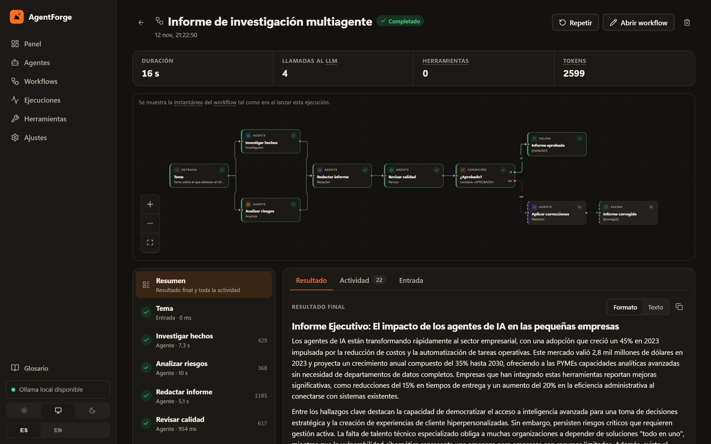

<p align="center">
  
</p>

<p align="center">
  <a href="https://github.com/Juaigles/agentforge/actions/workflows/ci.yml"></a>
  <a href="LICENSE"></a>
  
  
  
  
</p>

# AgentForge

Local-first web platform to build, run and monitor multi-agent AI workflows. Define agents (model, instructions,
tools), wire them together on a visual canvas and watch every run live, step by step.

Everything runs on your machine with [Ollama](https://ollama.com), or with any OpenAI-compatible API. Your data
stays in a local SQLite file. The UI is available in English and Spanish.

<p align="center">
  
</p>

## Features

- **Visual workflow builder**: drag agents and blocks (condition, for-each, sub-workflow, human approval, tool…)
  onto a canvas, validate the graph before running, undo/redo, copy/paste and full keyboard support.
- **Multi-agent engine**: parallel steps, branches, retries with backoff, time and call limits, cancel, retry from
  the failed step, and resume after a restart.
- **Live monitor**: streamed tokens, per-step results, tool calls, token usage and a workflow snapshot saved with
  every run.
- **Agents with a test bench**: model, instructions, temperature and tools, with streaming responses.
- **Tools**: 11 built-in (calculator, web, bounded file access, shared memory, delegation, sandboxed JavaScript…),
  custom HTTP tools from the UI, and [MCP](https://modelcontextprotocol.io) servers.
- **Triggers**: intervals, weekly schedules, cron (with time zones) and authenticated webhooks.
- **Import/export** of workflows and agents as JSON, **without secrets**.
- **Secure by default**: listens on `127.0.0.1` only, API keys encrypted at rest (AES-256-GCM), SSRF protection,
  backups, optional access token.
- **Tested**: 622 server tests, 382 UI tests and 216 end-to-end tests on Chromium, Firefox and WebKit
  ([evidence](TEST_RESULTS.md)).

<table>
  <tr>
    <td width="50%"></td>
    <td width="50%"></td>
  </tr>
  <tr>
    <td width="50%"></td>
    <td width="50%"></td>
  </tr>
</table>

## Quick start

Requires **Node.js ≥ 22.13** (developed and tested on v24) and [Ollama](https://ollama.com) with a chat model,
for example `ollama pull qwen3:8b`.

```bash
git clone https://github.com/Juaigles/agentforge.git
cd agentforge
npm install && npm run build && npm start   # opens http://127.0.0.1:4310
```

On first start, an empty database is seeded with an "Ollama local" provider, five sample agents and two
workflows. Without Ollama the app still starts, but agents can't run until you configure a provider in
_Settings_.

## Configuration

Set through environment variables. Invalid values stop the server with a message naming the variable.

| Variable                   | Default                  | Purpose                                                                    |
| -------------------------- | ------------------------ | -------------------------------------------------------------------------- |
| `PORT`                     | `4310`                   | Server port                                                                |
| `HOST`                     | `127.0.0.1`              | Network interface. Any non-local value **requires** `AGENTFORGE_TOKEN`     |
| `AGENTFORGE_TOKEN`         | (none)                   | Access token for the API and UI (16+ characters)                           |
| `AGENTFORGE_DATA_DIR`      | `data/`                  | Database, encryption key and workspace (use an absolute path)              |
| `OLLAMA_URL`               | `http://localhost:11434` | Ollama instance used for the sample data                                   |
| `AGENTFORGE_ALLOWED_HOSTS` | (none)                   | Extra host names/IPs the server answers to, comma-separated, without port  |
| `AGENTFORGE_TRUST_PROXY`   | `0`                      | `1` behind a reverse proxy (reads `X-Forwarded-For` / `X-Forwarded-Proto`) |
| `AGENTFORGE_SEED`          | `1`                      | `0` to skip the sample data                                                |
| `AGENTFORGE_LOG_LEVEL`     | `info`                   | `silent`, `error`, `warn`, `info` or `debug`; JSON logs on stdout          |

All data lives in `data/`: deleting it resets the app. Back it up from _Settings → Backups_ (a single `.afbackup`
file that includes the key needed to decrypt API keys) or copy the folder **while the server is stopped**.
Health and metrics: `GET /api/health/live`, `GET /api/health/ready`, `GET /api/metrics` (Prometheus format).
The remaining variables, Docker, reverse proxy and upgrade notes are in [docs/operacion.md](docs/operacion.md).

## Development

```bash
npm run dev          # API (tsx watch) + Vite at http://localhost:5173
npm run check        # lint + format + types + server and UI tests
npm run test:e2e     # end-to-end tests (Playwright); run `npx playwright install` once first
npm run test:e2e:all # the same on Chromium, Firefox and WebKit
npm run docs:api     # regenerate docs/api.md from the OpenAPI spec
```

```
shared/   Domain types, {{ref}} templates and graph validation (server + UI)
server/   Node + TypeScript + Fastify 5 + node:sqlite (db, llm, tools, engine, routes)
web/      Vue 3 + Vite + Pinia + Vue Router + Vue Flow
e2e/      Playwright suite with a deterministic fake model server (no Ollama needed)
```

See [CONTRIBUTING.md](CONTRIBUTING.md) to get started. The OpenAPI spec is served at `GET /api/openapi.json`.

## Security

By default the server only listens on `127.0.0.1`, rejects foreign `Host` headers and cross-site requests, and
blocks localhost and private networks in network tools (SSRF, with DNS pinning). `run_javascript` is **off by
default**; when enabled it runs in an isolated process, or in a network-less container for untrusted code. A local
MCP server is a program running with your permissions, so only add ones you trust. There are no user accounts:
whoever has the token can do everything. Details and how to report a vulnerability: [SECURITY.md](SECURITY.md).

## Documentation

> The in-depth documentation is written in Spanish.

| Document                                                 | Contents                                                     |
| -------------------------------------------------------- | ------------------------------------------------------------ |
| [docs/guia-usuario.md](docs/guia-usuario.md)             | User guide: models, agents, workflows, runs, triggers, tools |
| [docs/operacion.md](docs/operacion.md)                   | Configuration, backups, Docker, reverse proxy, upgrades      |
| [docs/solucion-problemas.md](docs/solucion-problemas.md) | Troubleshooting                                              |
| [docs/arquitectura.md](docs/arquitectura.md)             | Architecture and where to change what                        |
| [docs/api.md](docs/api.md)                               | API reference                                                |
| [CHANGELOG.md](CHANGELOG.md)                             | Release notes                                                |

## License

[MIT](LICENSE)
