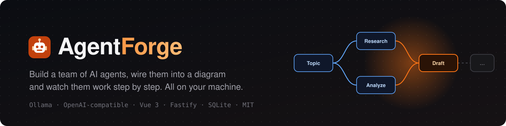
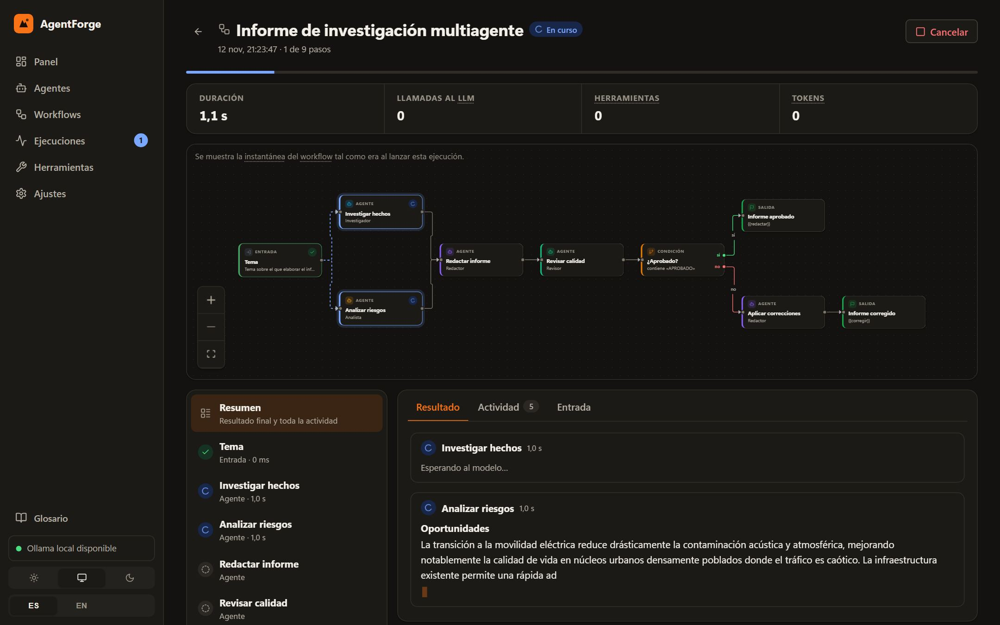
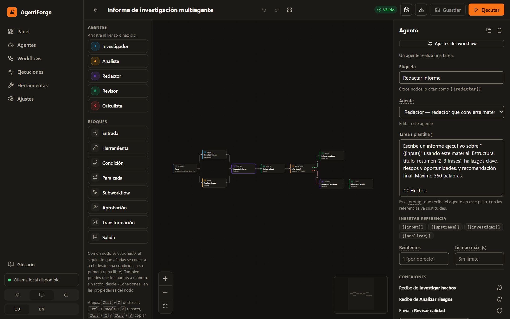
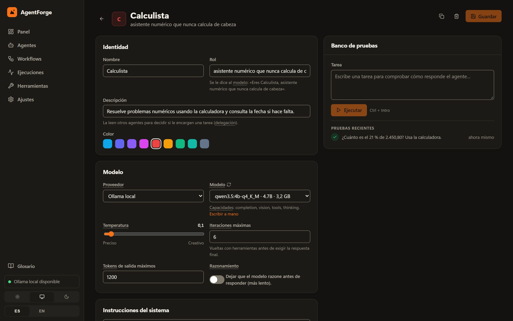
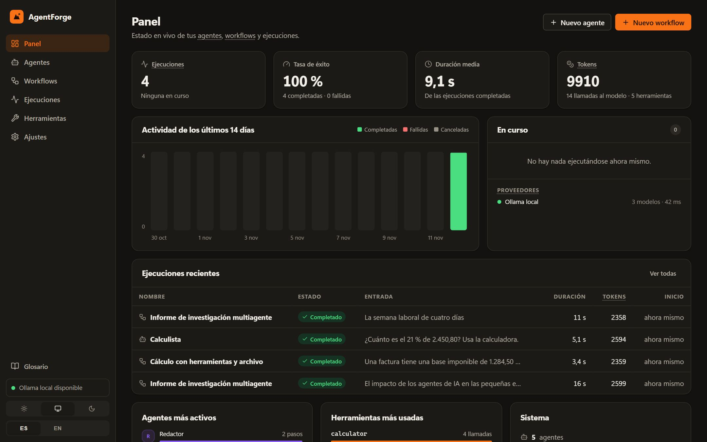

<p align="center">
  
</p>

<p align="center">
  <a href="https://github.com/Juaigles/agentforge/actions/workflows/ci.yml"></a>
  <a href="LICENSE"></a>
  
  
  
  
  
</p>

# AgentForge

Plataforma web local para crear, gestionar y ejecutar sistemas de agentes de IA: define agentes (modelo,
instrucciones, herramientas), conéctalos en workflows visuales y observa su ejecución en tiempo real.
Funciona al 100 % en tu equipo con [Ollama](https://ollama.com); opcionalmente con cualquier API
compatible con OpenAI.

> **English:** AgentForge is a local web platform to build multi-agent AI workflows on a visual canvas and watch
> them run live, step by step. It runs entirely on your machine with Ollama (or any OpenAI-compatible API). The
> interface is available in English and Spanish; the documentation is in Spanish.

<p align="center">
  
</p>

## Qué puedes hacer

<table>
  <tr>
    <td width="50%" valign="top">
      
      <p><strong>Dibujar el flujo.</strong> Arrastra agentes y bloques (condición, «para cada», subworkflow,
      aprobación humana, herramienta…) a un lienzo, conéctalos y valida el grafo antes de ejecutarlo. Deshacer,
      copiar y pegar y manejo completo con teclado.</p>
    </td>
    <td width="50%" valign="top">
      
      <p><strong>Ver qué pasó, paso a paso.</strong> Cada ejecución guarda sus eventos, el consumo de tokens y
      una instantánea del workflow. Cancela, reintenta desde el fallo o reanuda tras un reinicio.</p>
    </td>
  </tr>
  <tr>
    <td width="50%" valign="top">
      
      <p><strong>Definir y probar agentes.</strong> Modelo, instrucciones, temperatura y herramientas, con un
      banco de pruebas que responde en streaming.</p>
    </td>
    <td width="50%" valign="top">
      
      <p><strong>El estado de un vistazo.</strong> Ejecuciones en curso, tasa de éxito, consumo y actividad
      diaria. Disparadores con cron, intervalos y webhooks para que el trabajo se lance solo.</p>
    </td>
  </tr>
</table>

- **Motor multiagente**: pasos en paralelo, ramas, reintentos con espera, límites de tiempo y de llamadas,
  subworkflows, «para cada» y aprobación humana.
- **Herramientas**: 11 integradas (calculadora, web, archivos acotados, memoria compartida, delegación…),
  herramientas HTTP propias desde la interfaz y servidores [MCP](https://modelcontextprotocol.io).
- **Tus datos en tu equipo**: SQLite local, claves de API cifradas, protección frente a SSRF, copias de seguridad
  y exportación sin secretos.
- **Probado**: 622 tests de servidor, 382 de interfaz y 216 de extremo a extremo en Chromium, Firefox y WebKit
  ([evidencias](TEST_RESULTS.md)).

## Empezar en un minuto

```bash
git clone https://github.com/Juaigles/agentforge.git
cd agentforge
npm install && npm run build && npm start   # abre http://127.0.0.1:4310
```

Necesitas Node.js 22.13 o superior y [Ollama](https://ollama.com) con un modelo de chat
(`ollama pull qwen3:8b`, por ejemplo). Más detalles en [Puesta en marcha](#puesta-en-marcha).

## Documentación

| Documento | Para qué |
|---|---|
| [docs/guia-usuario.md](docs/guia-usuario.md) | Usar la aplicación: modelos, agentes, workflows, ejecuciones, disparadores, herramientas |
| [docs/solucion-problemas.md](docs/solucion-problemas.md) | Qué ves, por qué pasa y qué hacer |
| [docs/arquitectura.md](docs/arquitectura.md) | Las piezas, cómo viaja una ejecución y dónde tocar para cada cambio |
| [docs/api.md](docs/api.md) | Referencia de la API (generada de la especificación OpenAPI, `GET /api/openapi.json`) |
| [CONTRIBUTING.md](CONTRIBUTING.md) | Entorno, baterías, reglas de las pruebas y convenciones |
| [SECURITY.md](SECURITY.md) | Qué protege y qué no, y cómo informar de una vulnerabilidad |
| [CHANGELOG.md](CHANGELOG.md) | Cambios por versión |
| [docs/informe-hito5.md](docs/informe-hito5.md) | Informe final del hito 5: qué se hizo, qué sigue débil y qué no se ha verificado |
| [PLAN.md](PLAN.md), [PROGRESS.md](PROGRESS.md), [TEST_RESULTS.md](TEST_RESULTS.md) | Decisiones, estado y limitaciones, y evidencias de las pruebas |

## Requisitos

- **Node.js ≥ 22.13** (usa el módulo integrado `node:sqlite`). Todo se ha desarrollado y probado con **v24.19**;
  Node 22 no se ha probado.
- **Ollama** en marcha con al menos un modelo de chat (recomendado uno con soporte de herramientas, p. ej.
  `ollama pull qwen3:8b`). Sin Ollama la aplicación arranca igual, pero no podrá ejecutar agentes hasta que
  configures un proveedor en *Ajustes*.

## Puesta en marcha

```bash
npm install        # instala servidor y frontend (workspaces)
npm run build      # compila el frontend en web/dist
npm start          # API + interfaz en http://127.0.0.1:4310
```

En el primer arranque, si la base de datos está vacía, se crean datos de ejemplo: un proveedor «Ollama
local», cinco agentes y dos workflows (el modelo se elige automáticamente: el más ligero con soporte de
herramientas que tengas instalado).

### Desarrollo

```bash
npm run dev        # API (recarga con tsx watch) + Vite en http://localhost:5173
npm test           # tests del servidor y del frontend (unidad, API y componentes)
npm run test:e2e   # tests end-to-end en Chromium (Playwright) contra el servidor real
npm run test:e2e:all   # los mismos en Chromium, Firefox y WebKit
npm run check      # lint + formato + tipos + tests de servidor y frontend
npm run test:coverage  # tests con cobertura; falla si baja de los umbrales
npm run lint       # ESLint            ·  npm run format  aplica Prettier
npm run typecheck  # tsc + vue-tsc + tipos de la suite e2e
npm run loadtest -- --runs 10000,50000   # prueba de carga con el servidor real (no toca data/)
npm run docs:api   # vuelve a generar docs/api.md a partir de la especificación OpenAPI
```

La suite end-to-end necesita los navegadores de Playwright (`npx playwright install`, solo la primera vez;
`npx playwright install chromium` si solo vas a usar `npm run test:e2e`). Arranca su propio servidor en un puerto libre con datos temporales y un modelo simulado determinista,
así que no toca `data/` ni necesita Ollama. Detalles en [e2e/README.md](e2e/README.md).

### Configuración (variables de entorno)

| Variable | Por defecto | Uso |
|---|---|---|
| `PORT` | `4310` | Puerto del servidor |
| `HOST` | `127.0.0.1` | Interfaz de red (solo local por defecto) |
| `AGENTFORGE_DATA_DIR` | `data/` en la raíz del proyecto | Base de datos, clave de cifrado y espacio de trabajo. Una ruta relativa se resuelve desde donde arranca el proceso (con `npm start`, la carpeta `server/`): mejor una ruta absoluta |
| `OLLAMA_URL` | `http://localhost:11434` | Ollama usado para los datos de ejemplo |
| `AGENTFORGE_DEFAULT_MODEL` | (autodetectado) | Modelo de los agentes de ejemplo. Si Ollama no responde al sembrarlos, se usa `llama3.2` y se cambia después en cada agente |
| `AGENTFORGE_SEED` | `1` | `0` para no crear datos de ejemplo |
| `AGENTFORGE_TOKEN` | (sin clave) | Clave de acceso a la API (16 caracteres o más). **Obligatoria si `HOST` no es local** |
| `AGENTFORGE_ALLOWED_HOSTS` | (ninguno) | Nombres o IP adicionales por los que se llega al servidor, separados por comas y **sin puerto** (p. ej. detrás de un proxy o desde otro equipo) |
| `AGENTFORGE_TRUST_PROXY` | `0` | `1` si hay un proxy inverso delante: la dirección del cliente y el protocolo se leen de `X-Forwarded-For` y `X-Forwarded-Proto` (límite de tasa por cliente real y cookie `Secure`). Sin proxy debe quedar en `0` |
| `AGENTFORGE_LOG_LEVEL` | `info` | `silent`, `error`, `warn`, `info` o `debug` (este añade una línea por petición) |
| `AGENTFORGE_RATE_LIMIT` | `1200` | Peticiones por minuto y cliente a la API (0 = sin límite) |
| `AGENTFORGE_SHUTDOWN_GRACE_MS` | `10000` | Tiempo máximo que el apagado espera a las ejecuciones en curso |
| `AGENTFORGE_SCHEDULER_TICK_MS` | `5000` | Cada cuánto se comprueban los disparadores con horario vencidos (mínimo 250) |
| `AGENTFORGE_TEST_MODEL` | (autodetectado) | Modelo de los tests de integración |

La configuración se valida al arrancar: un valor incorrecto detiene el servidor con un mensaje que nombra la
variable. `AGENTFORGE_LOG=0/1` se sigue aceptando (equivale a `silent`/`debug`). El registro es JSON, una línea por
suceso, por la salida estándar; las credenciales nunca se escriben.

En *Ajustes → Datos* se configura la **retención del historial**: días que se conservan las ejecuciones
terminadas y número máximo de ejecuciones guardadas (0 = sin límite, el valor por defecto). Se aplica al
arrancar, cada hora, al terminar cada ejecución y al cambiar el ajuste.

Todos los datos viven en `data/` (`agentforge.db`, `secret.key`, `workspace/`). Borrar esa carpeta deja la
aplicación como recién instalada. Solo puede usarla un servidor a la vez (`agentforge.lock`). Antes de actualizar
el esquema de la base de datos se guarda una copia (`agentforge.db.v<N>.bak`).

### Copias de seguridad

En *Ajustes → Copias de seguridad* se crea, descarga, añade desde un archivo, restaura y borra. Una copia es un
único archivo `.afbackup` (en `data/backups/`) con la base de datos, la clave maestra y el espacio de trabajo; se
puede crear con ejecuciones en curso. **Restaurar** valida la copia y la deja preparada: los datos se sustituyen
al **reiniciar** el servidor, y lo que había se conserva en `data/replaced-<fecha>/`. Guarda las copias en un
lugar seguro: contienen la clave con la que se descifran las API keys.

Copiar a mano la carpeta `data/` también sirve, pero **con el servidor parado** (con él en marcha, parte de los
datos está en el diario `agentforge.db-wal`).

### Vigilarlo: sondas, métricas y registro

- `GET /api/health/live` — el proceso atiende (no exige clave). `GET /api/health/ready` — base de datos, carpeta de
  datos y planificador; 503 si falla algo.
- `GET /api/metrics` — métricas en el formato de texto de Prometheus: ejecuciones por estado, en marcha y en cola,
  llamadas a modelos y a herramientas, tokens, inventario, memoria del proceso, tamaño de la base de datos y
  respuestas HTTP por clase de estado. Exige la clave de acceso si hay una configurada
  (`Authorization: Bearer <clave>`).
- El registro es JSON, una línea por suceso, por la salida estándar (`AGENTFORGE_LOG_LEVEL`).

### En un contenedor

Hay un `Dockerfile` para uso local. **La imagen no se ha construido ni ejecutado con Docker** (el motor estaba
apagado al escribirla); sus etapas se han reproducido a mano fuera de Docker (ver `TEST_RESULTS.md`). Pruébala antes
de fiarte:

```bash
docker build -t agentforge .
docker run --rm -p 127.0.0.1:4310:4310 -v agentforge-data:/data --stop-timeout 20 \
  -e AGENTFORGE_TOKEN=una-clave-de-16-caracteres-o-mas \
  -e OLLAMA_URL=http://host.docker.internal:11434 agentforge
```

- La clave de acceso es obligatoria: dentro del contenedor el servidor escucha en `0.0.0.0`.
- Los datos viven en el volumen `/data`. Si montas una carpeta del equipo en su lugar, debe poder escribirla el
  usuario del contenedor (`--user "$(id -u):$(id -g)"`).
- Para entrar desde otro equipo, publica el puerto sin `127.0.0.1` y declara la IP o el nombre por el que se llega
  con `-e AGENTFORGE_ALLOWED_HOSTS=…` (si no, el servidor responde 403).
- `docker stop` hace un apagado ordenado; `--stop-timeout 20` le da tiempo a cerrar la base de datos.
- En Linux, `--add-host=host.docker.internal:host-gateway` para llegar al Ollama del equipo.

### Detrás de un proxy inverso

El servidor no cifra el tráfico. Para usarlo desde otros equipos con TLS, pon delante un proxy y:

- arranca con `AGENTFORGE_TOKEN`, `AGENTFORGE_ALLOWED_HOSTS=<nombre público>` y `AGENTFORGE_TRUST_PROXY=1`;
- haz que el proxy conserve la cabecera `Host` y envíe `X-Forwarded-For` y `X-Forwarded-Proto` (en nginx:
  `proxy_set_header Host $host; proxy_set_header X-Forwarded-For $remote_addr; proxy_set_header X-Forwarded-Proto $scheme;`);
- desactiva el búfer de respuestas para los flujos en vivo (`/api/stream/…` y `/api/runs/…/stream`; en nginx,
  `proxy_buffering off;`).

No se ha probado con un proxy real: lo comprobado son las cabeceras, con peticiones inyectadas en los tests.

### Actualizar a una versión nueva

1. Para el servidor (Ctrl+C) y, por si acaso, crea una copia de seguridad desde Ajustes antes de pararlo.
2. Sustituye el código **sin tocar la carpeta `data/`** (ahí están la base de datos y `secret.key`, la clave con
   la que se descifran las API keys: si se pierde, hay que volver a escribirlas).
3. `npm install`, `npm run build` y `npm start`.

El esquema de la base de datos se actualiza solo al arrancar. Antes de hacerlo se guarda una copia
`agentforge.db.v<N>.bak` junto a la base (no se borran solas: elimina las antiguas cuando todo vaya bien). Con
historiales grandes el primer arranque puede tardar decenas de segundos. No hay marcha atrás automática: para
volver a la versión anterior, mira «Datos» en [docs/solucion-problemas.md](docs/solucion-problemas.md).

### Parar el servidor

Ctrl+C (o `SIGTERM`) hace un apagado ordenado: las ejecuciones en curso quedan **interrumpidas**, no canceladas,
y al volver a arrancar la interfaz ofrece reanudarlas reutilizando los pasos ya terminados. Lo mismo ocurre si el
proceso muere de golpe. Un segundo Ctrl+C fuerza la salida.

## Qué incluye

- **Panel** con cifras reales: ejecuciones, tasa de éxito, duración media, tokens, actividad de 14 días,
  ejecuciones en curso (en vivo), salud de los proveedores, agentes y herramientas más usados.
- **Agentes**: editor con proveedor/modelo (lista real del proveedor), temperatura, límites, razonamiento,
  instrucciones y herramientas; **banco de pruebas** con respuesta en streaming.
- **Panel**, primera sesión: una guía de tres pasos (conectar un modelo, probar un agente, ejecutar un workflow)
  que se marca sola y explica cómo instalar Ollama si no responde.
- **Workflows**: constructor visual (Vue Flow) con paleta, inspector, plantillas `{{input}}`,
  `{{upstream}}`, `{{id_nodo}}`, validación en vivo (ciclos, referencias, agentes eliminados…),
  **deshacer y rehacer**, copiar y pegar, ordenado automático y manejo completo **con teclado** (ver «Teclado y
  accesibilidad»).
  Nodos: entrada, agente, herramienta, condición (ramas sí/no), **para cada** (repite con cada elemento de una
  lista un agente, una herramienta o un subworkflow, varios a la vez), **subworkflow** (otro workflow como un
  paso), **aprobación** (la ejecución espera a que una persona apruebe o rechace), transformación y salida.
- **Exportar e importar** workflows y agentes sueltos como archivos JSON que llevan todo lo que necesitan
  (agentes, subworkflows, herramientas HTTP, proveedores y disparadores) y **ningún secreto**. Antes de importar
  se revisa qué trae el archivo y qué hacer con lo que ya existe. Ver «Exportar e importar».
- **Disparadores**: un workflow puede lanzarse solo, y tener varios disparadores a la vez: cada cierto tiempo, a
  una hora ciertos días de la semana, con una expresión **cron** (con zona horaria y cambio de hora de verano) o
  al recibir un **webhook** autenticado con un secreto. Ver «Disparadores y webhooks».
- **Motor**: ejecución del grafo con paralelismo y límite de concurrencia, dependencias, ramas
  condicionales, reintentos con backoff, timeout por nodo, duración máxima, límite de llamadas al modelo,
  política de error (detener/continuar), cancelación, cola global, delegación entre agentes y memoria
  compartida por ejecución.
- **Ejecuciones**: historial con filtros (estado, tipo, workflow, agente y fechas) y búsqueda en el contenido (nombre, entrada y resultado), monitor en vivo (grafo con estados, streaming de tokens,
  registro de actividad con llamadas a herramientas), cancelar, repetir y **reintentar desde el fallo**
  reutilizando los pasos completados (y los elementos ya hechos de un «para cada»). Si el servidor se apaga con
  ejecuciones a medias, al volver la interfaz ofrece **reanudarlas** (o descartarlas) desde cualquier pantalla, o
  lo hace sola si se activa en *Ajustes*. Las **aprobaciones pendientes** se deciden desde un aviso visible en
  toda la aplicación.
- **Herramientas**: 11 integradas (calculadora, fecha, leer web, HTTP, archivos, memoria compartida,
  delegación, JavaScript aislado), herramientas HTTP personalizadas creadas desde la interfaz, herramientas de
  **servidores MCP** (programas locales o direcciones HTTP), banco de pruebas y visor del espacio de trabajo.
- **Ajustes**: proveedores (Ollama y compatibles con OpenAI) con prueba de conexión, límites y permisos.
- **Glosario** integrado: los términos técnicos muestran su definición al pasar el ratón, enfocar o tocar.
- **Español e inglés**, con selector de idioma y formatos de número y fecha de cada idioma. Ver «Idiomas».

### Exportar e importar

El botón de descarga de un workflow (o de un agente) genera un archivo `.agentforge.json` con:

- el workflow y los **subworkflows** que usa (también los que usan ellos);
- los **agentes** de sus nodos y los **proveedores** de esos agentes, sin claves de API;
- las **herramientas HTTP personalizadas** que usan los agentes y los nodos, sin el valor de las cabeceras con
  credenciales (solo su nombre, para saber qué hay que volver a escribir);
- los **disparadores** del workflow; los webhooks, sin secreto.

Al **importar** (botón *Importar* en Workflows o en Agentes) se muestra primero qué trae el archivo y cómo encaja
con lo que ya hay: cada elemento es *nuevo*, *ya existe* o *existe, pero es distinto*, y para cada uno se elige
crearlo, usar el de aquí, sustituir el de aquí o no importarlo. Por defecto se respeta lo que ya existe; un
subworkflow distinto del de aquí se importa como copia para no cambiar lo que hace el workflow. Un proveedor que
no existe se puede crear (sin clave) o sustituir por uno local. Se avisa si el archivo reparte herramientas que
actúan fuera de la conversación (`http_request`, `file_write`, `run_javascript`). Nada se crea hasta pulsar
*Importar*, y entonces **entra todo o nada**. Los disparadores importados quedan en pausa y los webhooks reciben
un secreto nuevo. Los archivos de la versión anterior del formato se siguen pudiendo importar.

Para automatizarlo: `POST /api/import/plan` y `POST /api/import` con `{ bundle, decisions }`.

### Disparadores y webhooks

En la lista de workflows o en el constructor, el botón del calendario abre los disparadores del workflow.

- **Cada cierto tiempo**: el intervalo se cuenta desde la ocasión prevista, no desde que se lanzó, así que el
  horario no se va retrasando.
- **Días y hora** y **cron** (cinco campos: minuto, hora, día del mes, mes, día de la semana; admite listas,
  rangos, pasos, nombres como `mon-fri` y alias como `@daily`). Sin zona horaria se usa la del equipo del servidor;
  con una zona (`Europe/Madrid`) el cambio de hora se aplica solo: una tarea a una hora fija se ejecuta una vez al
  día también el día del cambio. El formulario enseña las próximas cinco ocasiones antes de guardar.
- Los disparadores con horario **solo funcionan con el servidor en marcha**. Una ocasión con hora fija que llega
  con más de una hora de retraso (el servidor estaba apagado) no se ejecuta a deshora: se omite y queda anotado.
  Si la ejecución anterior del mismo disparador sigue en curso, la ocasión también se omite.
- **Webhook**: al crearlo se muestra **una sola vez** su secreto. Otro programa lanza el workflow con

  ```bash
  curl -X POST "http://127.0.0.1:4310/api/hooks/<id>" -H "Authorization: Bearer <secreto>" --data "texto de entrada"
  ```

  El cuerpo es la entrada del workflow (si es JSON con un campo `input`, ese campo). La entrada guardada en el
  disparador es una plantilla: `{{body}}` se sustituye por el cuerpo. En lugar del secreto en claro se puede enviar
  la firma `X-AgentForge-Signature: sha256=<HMAC-SHA256 del cuerpo con el secreto, en hexadecimal>`. La respuesta
  es `202` con el id de la ejecución. El webhook no usa la clave de acceso de la interfaz, pero sí pasa por la
  comprobación de `Host` y por el límite de peticiones: para llamarlo desde otro equipo, el servidor tiene que
  escuchar fuera de `127.0.0.1` y el nombre con el que se le llama debe estar en `AGENTFORGE_ALLOWED_HOSTS`.

### Servidores MCP

En *Herramientas → Servidores MCP* se conecta un servidor [MCP](https://modelcontextprotocol.io): un **programa
local** (AgentForge lo arranca y habla con él por su entrada y salida estándar) o una **dirección HTTP**
(Streamable HTTP). Sus herramientas aparecen en el catálogo como `servidor__herramienta` y se asignan a los
agentes o se usan en nodos de herramienta como cualquier otra. Las variables de entorno y las cabeceras se guardan
cifradas y no se vuelven a mostrar. Si el servidor se cae, sus herramientas siguen existiendo y la siguiente
llamada intenta reconectar. Solo se usan sus herramientas (no sus recursos ni sus plantillas de prompt), y no hay
inicio de sesión OAuth: la autenticación HTTP es por cabeceras.

## Idiomas

La interfaz está en **español e inglés**. El selector está al pie de la barra lateral (ES / EN): cambia al
instante, se recuerda en el navegador y, si no se ha elegido, se usa el idioma del navegador. Números, fechas y
duraciones siguen al idioma.

El servidor escribe sus textos en español y acompaña cada uno que llega a la pantalla de su **código y sus
parámetros**; con ellos la interfaz en inglés lo traduce: los errores de validación de un formulario (junto a su
campo), los errores de la API, el motivo de fallo de una ejecución o de un paso, los errores de las herramientas y
los avisos de una importación. El texto en español sigue en la respuesta como respaldo para quien no traduzca, y
lo que viene de fuera (la respuesta de un proveedor o de una API) se muestra tal cual dentro de la frase
traducida. Los títulos y descripciones de las herramientas integradas se traducen en la interfaz por nombre de
herramienta; la descripción que lee el modelo no cambia.

Siguen en español con la interfaz en inglés: los datos de ejemplo, las ejecuciones anteriores a esta versión (no
tienen código guardado), lo que el motor escribe dentro de un resultado (el resumen de un «para cada») y los
errores que solo se devuelven al modelo. El detalle está en `PROGRESS.md`.

Para añadir un texto del servidor: una entrada en `shared/server-messages.ts` y su traducción en
`web/src/lib/server-messages-en.ts` (el compilador y un test exigen los mismos códigos), y en el servidor
`msg('código', { parámetros })` al construir el error o el aviso.

Para añadir textos: `web/src/i18n/es/<ámbito>.ts` y `web/src/i18n/en/<ámbito>.ts` con las mismas claves (un test lo
comprueba), y en el código `t('ámbito.clave')` o `tn('ámbito.clave', n)` para plurales, importados de `@/i18n`.

## Teclado y accesibilidad

La interfaz está pensada para cumplir WCAG 2.1 AA: todo se puede hacer sin ratón, el foco siempre se ve, los
diálogos lo atrapan, los cambios de estado se anuncian a los lectores de pantalla y el contraste se ha medido en
los dos temas. Lo que falta está en `PROGRESS.md` («Pendiente y limitaciones»).

| Dónde | Tecla | Qué hace |
|---|---|---|
| Cualquier página | Tab (primera parada) | «Saltar al contenido» |
| Diálogos | Esc | Cierra el diálogo de arriba y devuelve el foco |
| Constructor | Ctrl+Z / Ctrl+Mayús+Z (o Ctrl+Y) | Deshacer / rehacer |
| Constructor | Ctrl+C, Ctrl+V, Ctrl+D | Copiar, pegar y duplicar los nodos seleccionados |
| Constructor | Supr | Borrar el nodo o la conexión seleccionados |
| Constructor | Ctrl+S | Guardar (también mientras se escribe en un campo) |
| Constructor, sobre un nodo | Intro o Espacio | Abrir sus propiedades; Esc, desde un campo de las propiedades, vuelve al nodo |
| Constructor, sobre un nodo | Flechas | Moverlo |
| Cuadros de tarea | Ctrl+Intro | Ejecutar |

Para **conectar nodos sin arrastrar**, abre un nodo y usa el bloque «Conexiones» de sus propiedades. La lista
«Nodos» de los ajustes del workflow lleva a cualquier nodo sin pasar por el lienzo.

Si el servidor deja de responder, una franja lo avisa en todas las pantallas y la interfaz se reconecta sola.
Los filtros del historial se guardan en la dirección (`/runs?estado=failed&tipo=workflow&q=informe`).

## Arquitectura

```
shared/   Tipos del dominio, plantillas {{ref}} y validación de grafos (los usan servidor y frontend)
server/   Node + TypeScript (tsx) + Fastify 5 + node:sqlite
  src/db        esquema, migraciones y Store
  src/crypto    cifrado AES-256-GCM de las API keys
  src/llm       adaptadores Ollama nativo y OpenAI-compatible (streaming + tool-calls)
  src/tools     registro, herramientas integradas, validación, protección SSRF, sandbox
  src/engine    agent-runner, workflow-engine, run-manager, scheduler
  src/routes    API REST + SSE
  src/openapi.ts, metrics.ts, version.ts   especificación de la API, métricas y versión única
  test/         tests de unidad, protocolo, motor, API, persistencia e integración con Ollama
web/      Vue 3 + Vite + Pinia + Vue Router + Vue Flow
  src/**/*.test.ts   tests de lógica y de componentes (Vitest + Vue Test Utils, contra la API real)
e2e/      Suite end-to-end (Playwright) y servidor que simula el protocolo de Ollama/OpenAI
```

Decisiones y su porqué en [PLAN.md](PLAN.md); estado y problemas resueltos en [PROGRESS.md](PROGRESS.md);
evidencias de pruebas en [TEST_RESULTS.md](TEST_RESULTS.md).

### Añadir una herramienta en código

Crea un objeto `ToolDefinition` (nombre, descripción, esquema de parámetros y `execute`) y añádelo a
`BUILTIN_TOOLS` en `server/src/tools/builtin.ts`, o regístralo con `registry.register(...)`. Aparecerá en
el catálogo, en el editor de agentes y en el constructor. Para una integrada, añade también su título, descripción
y parámetros en `web/src/i18n/es/builtinTools.ts` y `en/builtinTools.ts`, y su categoría en
`web/src/lib/tool-text.ts` (un test lo exige): así se rotula en el idioma de la interfaz.

## Seguridad

- El servidor escucha solo en `127.0.0.1`. Rechaza siempre las peticiones con un `Host` que no sea suyo (DNS
  rebinding) y las que proceden de otra web (CSRF), y responde con una política de contenido estricta (CSP),
  `X-Frame-Options: DENY` y `nosniff`.
- **Para usarlo desde otros equipos** hace falta una clave de acceso: con `HOST=0.0.0.0` (o cualquier dirección que
  no sea local) el servidor **no arranca** si no se define `AGENTFORGE_TOKEN`. La interfaz la pide al entrar; los
  clientes de API la envían como `Authorization: Bearer <clave>`. Detrás de un proxy inverso, declara su nombre en
  `AGENTFORGE_ALLOWED_HOSTS`. No hay cuentas ni permisos: quien tiene la clave puede hacerlo todo.
- Las API keys de los proveedores se cifran en reposo (AES-256-GCM), la API nunca las devuelve y **no se envían a
  una dirección distinta de aquella para la que se guardaron**: si cambias la URL de un proveedor hay que volver a
  escribir la clave. Las cabeceras de las herramientas HTTP personalizadas cuyo nombre indica una credencial
  (`Authorization`, `Cookie`, `X-API-Key`, `…-Token`, `…-Secret`…) también se cifran, la API devuelve solo su
  nombre y no viajan en los archivos exportados; el resto de cabeceras se guarda en claro.
- Los **webhooks** se autentican con un secreto propio de cada uno (se guarda cifrado, se compara en tiempo
  constante y se puede regenerar); no dan acceso al resto de la API.
- Un **servidor MCP local es un programa que se ejecuta en el equipo del servidor con sus mismos permisos**, y
  cualquier servidor MCP decide qué hacen sus herramientas: añade solo los que conozcas. Sus variables de entorno
  y cabeceras se cifran en reposo. Solo hereda las variables de entorno básicas del sistema, no las de AgentForge.
- Hay un límite de peticiones por cliente, más estricto para lo que lanza ejecuciones y para el inicio de sesión.
- Las herramientas de red bloquean por defecto localhost y redes privadas (SSRF), también en redirecciones y
  en cualquier notación de la dirección (IPv4 mapeada en IPv6, decimal, NAT64…). La conexión se hace siempre a la
  IP que se validó (**fijación de DNS**), así que un DNS malicioso no puede cambiarla entre la comprobación y la
  conexión (DNS rebinding). Al seguir una redirección hacia otro sitio no se reenvían las cabeceras de la
  herramienta (credenciales), y nunca pueden llamar a la propia API de AgentForge.
- Las herramientas de archivos están confinadas a `data/workspace`.
- `run_javascript` está desactivada por defecto. Al activarla se elige en *Ajustes* dónde corre el código:
  - **Proceso aislado** (por defecto): un contexto `node:vm` vacío (sin `require`, `process`, `fetch`,
    temporizadores ni `eval`) dentro de un **proceso hijo** lanzado con el modelo de permisos de Node
    (`--permission`) y sin variables de entorno, con límites de tiempo (5 s), memoria (64 MB) y tamaño de salida.
    El proceso **no tiene red**: donde Node ofrece permiso de red lo deniega el propio modelo de permisos; en
    Node 22–24, que no lo ofrece, el proceso inutiliza sus API de red antes de ejecutar nada. El servidor lo
    comprueba con una conexión real y Ajustes muestra el resultado.
    **Lo que NO es:** no es una frontera del sistema operativo. `node:vm` no está diseñado para código hostil.
  - **Contenedor** (Docker o Podman): el mismo programa en un contenedor sin red (`--network none`), de solo
    lectura, sin privilegios ni capacidades y con límites de memoria, CPU y procesos. Es la opción para código en
    el que no confíes. Necesita el motor en marcha y la imagen `node:24-alpine` descargada (`docker pull
    node:24-alpine`); AgentForge no la descarga por su cuenta.
- El espacio de trabajo tiene cuota: 5 MB por archivo y 100 MB en total.
- La salida de los modelos se renderiza como Markdown saneado con DOMPurify.

## Limitaciones conocidas

Ver la sección «Pendiente y limitaciones» de [PROGRESS.md](PROGRESS.md).

## Licencia

[MIT](LICENSE): puedes usar, copiar, modificar y distribuir AgentForge, también con fines comerciales, siempre que
conserves el aviso de copyright y el de la licencia. Se entrega tal cual, sin garantía.
